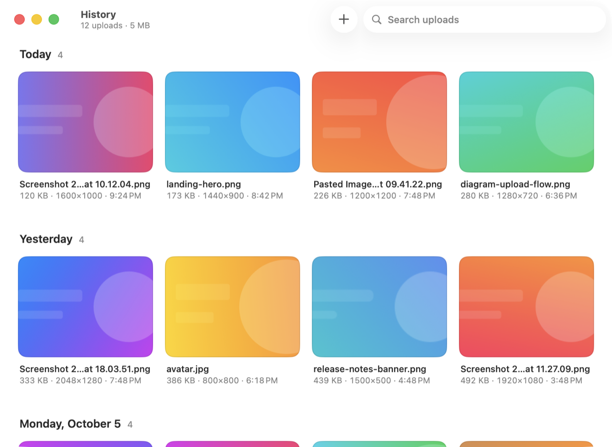

<p align="center">
  
</p>

<h1 align="center">Pinup</h1>

<p align="center">
  A macOS menu bar app that uploads images and copies the link to your clipboard.
</p>

<p align="center">
  
  
  <a href="LICENSE"></a>
</p>

<p align="center">
  
</p>

Pinup is written in Go, with its windows drawn by [MyGo](https://github.com/egoist/mygo)'s native UI.

## Features

- Upload by dropping files on the menu bar icon, or with global shortcuts for the clipboard and for screenshots.
- Copy links as Markdown, a plain URL or an HTML `` tag.
- Upload to any S3-compatible bucket or HTTP upload API, and switch between as many hosts as you add.
- Convert images to JPEG or HEIC, and strip location data before upload.
- Browse, search and re-copy past uploads in History.
- Script uploads from Shortcuts, Raycast or the shell with `pinup://` URLs.

## Requirements

- macOS 14 or later
- Go 1.27 or later

## Installation

```sh
go tool mygo build
open build/darwin-arm64/Pinup.app
```

MyGo builds and ad-hoc signs `Pinup.app`, and a disk image beside it. Move the app to `/Applications` to keep it.

On first launch, add a host in **Settings > Hosts** and press **Test Upload** to check it.

## Usage

| Action | Uploads |
|---|---|
| Drop on the menu bar icon or the History window | The dropped files |
| ⌥⇧⌘U | Files copied in Finder, or the image on the clipboard |
| ⌥⇧⌘S | A screen area or window you select |
| Menu > Upload Files… (⌘O) | Files you choose |

When a batch finishes, its links go to the clipboard, one per line. Open past uploads with **Menu > Show History** (⌘Y). Both shortcuts can be changed in Settings.

See [Usage](docs/usage.md) for retries, failed uploads, History actions and where Pinup stores its data.

## Hosts

A host is a named place uploads go. You add hosts in Settings, each from one of two providers, and pick one in **Settings > Hosts** or the menu's **Upload To**:

- **S3-compatible storage**, such as AWS S3, Cloudflare R2, Aliyun OSS, Tencent COS and MinIO
- **Custom HTTP API**, where you set the request and where to find the link in the response

See [Hosts](docs/hosts.md) for every field, with example setups.

## Automation

```sh
open "pinup://upload-clipboard"
open "pinup://screenshot"
open "pinup://upload?path=~/Desktop/shot.png"   # repeat path= for more files
open "pinup://retry"                             # retry failed uploads
open "pinup://history"
open "pinup://settings/hosts"                    # or general, shortcuts
```

## Development

```sh
go test ./...              # run the tests, each in a temporary folder
scripts/dev.sh             # run with live reload, with data of its own
```

See [Development](docs/development.md) for launch flags, environment variables and the project layout.

## License

[MIT](LICENSE)
